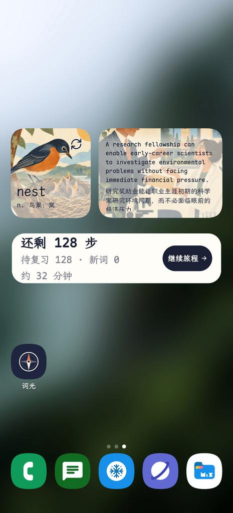
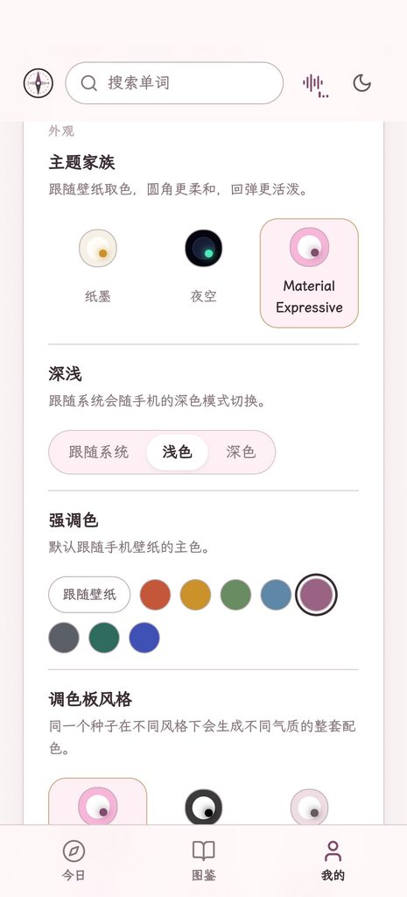

<div align="center">

<table align="center">
  <tr>
    <td></td>
    <td></td>
    <td></td>
    <td></td>
    <td></td>
  </tr>
</table>

# word-atlas-android

**Word Atlas in your pocket: a fully offline Android build.**

7,298 IELTS entries · original illustrations · bundled UK & US speech · exam sentences · zero permissions · works with no network

[](LICENSE)
[](CONTENT_LICENSE.md)


[简体中文](README.md)

</div>

---

## How it differs from upstream word-atlas

In one line: **same content, different runtime.** Upstream is about getting the words into your head; this repository is about making the app run on a phone with no network, no server and no system speech pack.

### At a glance

| | **word-atlas** (upstream) | **word-atlas-android** (this repo) |
| :--- | :--- | :--- |
| Form | Web app + open dataset | Android APK (the same front end inside) |
| Runtime | A browser on the hosted site or `npm run dev` | Android WebView over `file:///android_asset/www/index.html` |
| Network | Required: media is fetched and may be cached for offline use | **None**: no `<uses-permission>` at all, `INTERNET` included |
| Local server | Vite dev server / static host | No server, no listening port |
| Data loading | `fetch()` of sharded JSON | Inlined at build time into `atlas-embed/data.js`, assets ship in the APK |
| Fallback speech | Browser `speechSynthesis` / system TTS | Bundled Kokoro-82M (sherpa-onnx), no system TTS needed |
| Save & share | Browser download link | Saved to "Download / Word Atlas", then the system share sheet |
| Lookup from other apps | No — only its own search box | Registers `PROCESS_TEXT` (long-press → Translate) and `ACTION_SEND` (share text), so a word from any app lands in the atlas search and in "recently looked up" |
| Themes | Light / dark / follow system | Adds the aurora and starlight night skies and three English faces |
| Word card | One transcription line | Both readings of a heteronym, UK and US side by side; an **etymology note** beneath the transcription and a **same-root words** row at the bottom; tap the headword for syllables; words in examples, translations, collocations, families, same-root words, synonyms and the gloss all open a lookup popover |
| Exam sentences | None | A **real exam sentences** section under "IELTS context": 1,211 Cambridge IELTS 4 sentences with translations and a source chip |
| Topic constellations | None (the vocabulary star map only) | The atlas gains a **topic constellation** panel: nineteen topics, one constellation each |
| Ambience | None | **30** looping recordings, loudness-matched, ducked while a word is read |
| Size | ~1 GB of assets in the repo | Share **1.39 GB** / private **1.33 GB** |
| Updating | `git pull` / the site updates itself | Rebuild and reinstall (a new signing key needs an uninstall first — export a backup beforehand) |
| Toolchain | Node + Vite | Plus JDK 17 and the Android SDK, **no Gradle** |

### Three hard guarantees

| Guarantee | How it holds |
| :--- | :--- |
| **It cannot reach the network** | `AndroidManifest.xml` declares no `<uses-permission>` whatsoever. Without `INTERNET` the kernel refuses to create sockets for this UID; no code path gets around it. Cleartext traffic is off and the network security config trusts system CAs only. |
| **There is no server** | The page is opened from `assets/www` inside the APK over `file://`, with images and audio referenced relatively. Nothing listens on a port and no proxy intercepts requests. |
| **Nothing is downloaded at runtime** | The word index, 73 entry shards, the exam-sentence and syllable indexes and 17 UI cues are inlined at build time; each of the 30 ambience loops ships as a script injected on demand (`fetch()` does not work under `file://`), so only the chosen one loads; 7,298 illustrations, 7,298 thumbnails and 29,402 recordings ship as files. Not a single network request at runtime. |

Also: no accounts, no analytics, no tracking, no third-party SDKs.

### Added for the phone

These are not by-products of "porting to Android" — they are what this build genuinely adds:

- **The study screens are laid out for one screen.** On a phone the old quiz could not fit four options and a verdict at once: the feedback was a sticky bottom sheet that landed exactly on the last two answers, and a picture question needed a scroll before all four were visible. The session page is now pinned to `100dvh`, the prompt area absorbs the leftover height (illustration, listen orb and spell plate are all capped in `dvh`), and the options keep a fixed slot at the bottom. After answering, the feedback card **takes the options' place** instead of covering them. Desktop keeps the two-column options with the card beside them.
- **Answers and word cards are laid out for the thumb.** The four options grew from 54 px to 68 px, moved from 8 px to 26 px off the bottom edge, and lost their 1–4 badges (the number keys still pick an answer, they are just no longer drawn on the buttons). The card shown after answering is no longer something to merely glance at: it plays the word and its example, the headword opens the full entry, an example translation can start blurred until tapped, and examples, translations, collocations, word families, synonyms — even the half-sentence of English inside a gloss — all open a lookup popover. Settings can also read the daily and IELTS-context examples aloud after the word, one after another, stopping the moment you navigate away.
- **Real exam sentences under the card.** 1,211 sentences from Cambridge IELTS 4, English and Chinese, were imported from the third-party *IELTS Exam Sentence Dictionary* and matched to 2,216 entries: below "IELTS context" the card gains a **real exam sentences** section tagged with its source (`C04T2L3` is book 4, Test 2, Listening Part 3), with a Chinese translation and a "next sentence" button when a word has several. These have no recording, so the bundled Kokoro voice reads them. The importer is `scripts/atlas/import_ielts.py`, and it keeps only sentences that actually contain the word — the dictionary itself links `visitor` to a sentence about "a variety of shopping", which under a headword only confuses.
- **Tap the headword to see its syllables.** Tapping the big word on a card puts a `·` between syllables — `ex·hib·ition` — and tapping again puts it back. The breaks are not guessed: they come from the `syllable` attribute on OALDPEX headwords (`scripts/atlas/import_syllables.py` extracts 4,672 of them), so they match the printed dictionary. A splitter trained on the same data only reproduced 82% of even the two-syllable breaks, so nothing is invented for the entries the dictionary leaves unmarked: `study` and `hotel` simply do not change when tapped.
- **The card gains an etymology note.** Between the transcription and the meaning there is now a 词源图景 line that reads the word's literal sense out of its root: `concur` is `com-` (together) + `currere` (to run), "to run together to one point"; the `libr-` of `library` was "tree bark", which is what a book was made of. 6,754 entries carry it (92.6%); what is missing are proper nouns, British spellings and irregular plurals (`Thursday`, `colour`, `children`). The same dictionary adds a **same-root words** row and the words from its synonym notes: under `rebellion` you get `belligerent`, `bellicose`, `antebellum`, all from Latin `bellum` (war), each one tap away from a lookup. The importer is `scripts/etymology/import_etymology.py` — the source MDX is `Encrypted="2"`, so its key table is locked, but its record blocks are plain zlib; the script reads those and never touches the key table.
- **The atlas gains topic constellations.** Each of the nineteen IELTS topics gets a constellation drawn on its own stars: a seeded Poisson sampling picks a handful of neighbouring words inside that topic's nebula, then a **non-crossing** spanning tree links them, so the figure never tangles; 55% of the time one long chord is added, but only if both ends have degree below 3, the chord is at most 1.5× the median edge and the two ends are at least three hops apart on the tree — so a triangle can never appear. Once 80% of a topic's words are learned the constellation lights up, and both the card and the star map share one pair of states: fully dashed when unlit, gold and glowing when lit. Tapping a card flies the star map to it.

  The figure reads as two-dimensional without thickening the galactic disc: every topic also has its own 2D "nebula" in the plane (long axis tangential, short axis radial, cos² falloff, zero beyond 0.15), and only the words on that stretch of arm near the nebula centre are pushed apart. Widening the angular spread of the spiral arms instead was tried once and smeared the whole sky's colour zoning into grey-purple — the nebula is the only way to get topic separation without sacrificing the palette. Links only ever join words of the same topic.

- **The ambience is real recording, not synthesis.** 30 loops: rain, sea, forest, fire, café, insects, frogs, wind and snow, campfire, train, piano, bamboo flute, guqin, harp… taken from another open learning site, [gjenglish.com](https://gjenglish.com) ([repository](https://github.com/wenchester8-droid/english-starry-sky)), at a pinned commit (most are Pixabay recordings used under the Pixabay Content License; three were synthesised upstream). Each is loudness-matched against upstream's dB table, so switching tracks needs no volume change; the level ducks to 30% while a word is read, and the chosen track is remembered next launch. `scripts/fetch_ambience.py` fetches them and records byte count and SHA-256 per track; `--check` re-verifies every one.

- **The keyboard no longer covers the page.** The typing stages drive an invisible `<input>` that is focused from the moment it mounts, and a WebView ignores `focus()` on an already-focused element — so on a real phone tapping the stage did nothing at all. It now blurs before focusing and asks the native layer for `showKeyboard()` explicitly; the viewport also carries `interactive-widget=resizes-content`, so the layout reflows into the shrunken viewport and the spell and typing fields always sit above the keyboard.
- **Bundled offline speech.** Only 1,011 words used to have a recording for their second (IELTS-context) example, and the other 6,287 fell back to system TTS — silence on a machine without an English voice pack. They were then handed to the bundled Kokoro-82M; 1.0.8 mirrors the missing 6,287 clips from the upstream public site by entry (the sentences match ours word for word, the format the same 44.1 kHz mono 64 kbps), so both examples are now human recordings. Only the exam sentences still go through Kokoro, at 24 kHz, pre-rendered before the tap, so pressing play is instant.
- **Share cards work.** Under `file://` every document is its own opaque origin, so `drawImage` taints the canvas and `toBlob()` returns `null`. Illustrations are now read as `data:` URLs before drawing; after saving, the native layer opens the system share sheet with `ACTION_SEND` (a WebView has no `navigator.share({files})`).
- **The back button has layers.** Close the lookup popover, then the word card, then the previous page, and only then leave the app.
- **Themes follow the phone.** A WebView answers `prefers-color-scheme` from the app's own theme, which is why "follow system" used to stay dark forever on a light phone; the native layer now reads `Configuration.uiMode` and pushes it to the page.
- **"Import backup / clear records" are clickable.** With no `WebChromeClient` configured, `confirm()` silently returned `false` and the file picker never opened. Adding `onJsConfirm` / `onShowFileChooser` fixed both.
- **Progress travels to the web edition, and back.** Upstream's importer is far stricter than this app's: it re-validates the whole file and rejects it outright if `progress.drills` is missing or one of the 22 settings it knows is absent (`examDate`, `illus`, `recall`…), which is why every export from this app ended in 「备份内容不完整或格式有误」. "Me → Data" therefore gains two buttons: **export a web-compatible backup** (adds `drills: {}` and every setting the site expects; of this app's 30 ambience tracks only the 8 it knows are sent, the rest become `stars`; a `days` entry with `c > r` is clamped to `r`) and **import a web backup** (drops `drills`, `books` and the exam plan, keeping cards, daily stats and the settings both sides can express). The rules are restated in `src/store/web-backup.ts` and pinned by eight tests that replay upstream's validation; a 895-word backup exported from a real device imported on [0xlei.tech/words](https://0xlei.tech/words/) as 「已恢复 895 个词的学习记录」.

- **Looked-up words can be found again.** The upstream search palette has a "recently looked up" row; this build only ever showed a static hint. The panel now previews the **six most recent lookups** on an empty query, with **Clear** and **View all N →** on the right of the section title, and offers six day-rotated "try these words" chips when there is no history yet. Picking a search result, a suggested chip, a recent row — or opening a word from the atlas after typing into its search field — records a lookup. "Recently studied" on the practice page is FSRS progress and stays completely separate. A standalone `#/history` page lists all of them (cap **20**), most-recent first, numbered but **without timestamps**, reachable from "Me → Lookup history"; its empty state opens the search palette directly. The data lives under its own `word-atlas:recent-search` key as a bare `string[]` (`[id, ...old.filter(x => x !== id)].slice(0, 20)`), **outside `Progress`, outside every backup, and untouched by "clear records"**. Malformed JSON, failed writes and IDs from another dataset degrade silently. The palette also regains the upstream mobile affordances: a **Cancel** button, `enterKeyHint="search"`, and overlay registration so the hardware back key closes the panel before it navigates away. See `src/lib/recent.ts` and `src/lib/recent.test.ts` (ten tests).
- **Words can be looked up from other apps.** 1.0.10 registers `ACTION_PROCESS_TEXT` and `ACTION_SEND` (`text/plain`), so long-pressing a word anywhere and choosing "Translate" lists 词光, and the same word sent through the share sheet lands in the atlas search. The native layer reads `EXTRA_PROCESS_TEXT` (a `CharSequence`, so `getCharSequenceExtra`, not `getStringExtra`) and falls back to `EXTRA_TEXT`, collapses whitespace, caps the query at 120 characters — a share sheet can carry a whole paragraph — and hands the page `#/atlas?q=<url-encoded>&waSource=external`. The page records the match in "recently looked up" and, when the query is an exact spelling, opens the card straight away, so choosing it from a translate menu feels like a dictionary rather than a search box. No new permissions; still fully offline.

- **The whole UI kit now sounds like the night sky, and taps are decided on release.** Before 1.0.11 only flips, verdicts and opening an entry made a sound — `tap.mp3` shipped but was never wired up. Measuring all 47 audio files exposed the real cause: the upstream mastering chain in `scripts/atlas/build_sfx.py` contains `afade=t=out:st=0:d=0.001`, which fades to silence *from second zero* and leaves only ~10 ms of audio in 9 cues (source peaks −21…−32 dBFS). After the low playback gains and the default ambience bed they were inaudible on a phone; `twinkle` had a full waveform but was mastered at `I=-24 LUFS` and played at 0.22. `scripts/atlas/gen_cosmic_sfx.py` now rebuilds **11 cues with the ElevenLabs sound-effects API** (tap, key, flip, page, correct, wrong, start, complete, streak, twinkle, splash-burst). The prompts demand a *pitched* glass-bell note at 0.8–2.5 kHz and explicitly rule out bass swells and airy hiss — the first prompts were too "ambient": `start` carried almost all of its energy below 500 Hz and was nearly silent on a phone, while several others were nothing but >4 kHz shimmer, so all of them were discarded and regenerated. A hand-rolled sine synthesis attempt was also rejected as dull and samey. Mastering trims the silent head and tail, applies a 600 Hz high-pass, level-matches each cue to −20 dBFS on its loudest 100 ms with a −3 dBFS peak ceiling, and verifies the 500 Hz–4 kHz band dominates; raw takes are cached in `.local/forge/sfx/` so re-runs cost no credits. Playback gains are calibrated against the ambience bed (~−31 dBFS) to a uniform 0.60 (tap 0.45), putting the 11 cues 3.6–6.1 dB above the bed — the same range as the already-clear `fly` (6.0 dB) and `ignite` (9.0 dB) — so **all 17 UI cues are audible**. `build_sfx.py` skips those names and its broken fade is fixed. The same upstream bug is reported at [designfuchen/word-atlas#48](https://github.com/designfuchen/word-atlas/issues/48).
- **A swipe is no longer a tap.** Feedback used to fire on `pointerdown`, so any scroll that happened to start on a button produced a click and a buzz. It is now classified on `pointerup`: >10 px of travel, a >600 ms hold, `pointercancel` or a second finger cancels the gesture, and a 130 ms cooldown stops double taps becoming a run. Only **real controls** respond (buttons, links, switches, segmented controls, sliders, selects); blank space, star-map drags, non-button cards and scrolling stay silent, while Enter/Space activation still gets one. **One buzz per action** — flips and verdicts reached from the keyboard get one too (a touch has already buzzed and stands down), while page transitions, finishing a typing item and opening a word sheet do not. The cue engine also gained a soft-limited bus, an eight-voice cap, 1.5/12 ms envelopes and boot-time decoding; the ambience bed bypasses the limiter. A **UI vibration** switch sits directly under "UI sounds" in "Me"; the two are independent — sound off can still vibrate and vice versa — and enabling it plays a sample haptic at once. Vibration goes through the native `WordAtlasAndroid.vibrate()` bridge to `View.performHapticFeedback` (one constant each for tick, click, success and error), which the window manager performs on the app's behalf: **no `VIBRATE` permission is needed and the manifest still declares no `<uses-permission>` at all**. The web build falls back to `navigator.vibrate`. Typing feedback was also missing from the **spell quiz** (the "continue journey" study page): IME input emits no pointer events, so the global tap listener never saw it and `SpellInput` had neither a `cue("key")` nor a haptic — only the Practice typing page made a sound. Both now share `typingFeedback()`: one typewriter clack per new character, with the buzz throttled to 110 ms so fast typing stays subtle. `key.mp3` was regenerated as a **single** vintage typewriter key press: several ElevenLabs candidates were scored by onset count, and mastering cuts to 0.12 s so a repeated burst can never slip through. It is mid-range, hiss-free, and decoded at boot so the first character is instant. See `src/lib/feedback.ts`, `src/lib/sound.ts`, `src/lib/native.ts`, `scripts/atlas/gen_cosmic_sfx.py` and `MainActivity.Bridge.vibrate`.
- **The bottom bar can keep just three tabs.** "Me → Appearance" gains a **Hide practice** switch. With it on, the bottom navigation drops to Today, Atlas and Me, and the three resize to fill the row evenly — no blank gap and no tab shoved to the left. When Today has no active study session, its "typing practice" entry is folded away too. Toggling it while standing on the practice screen bounces you back to Today so you never land on a hidden page, and the setting travels with backups and the web edition.
- **Each kind of example has its own reading speed.** Since 1.1.1, "Me → Sound" keeps the two auto-read switches together and puts three rows under them — **daily example**, **IELTS-context example** and **exam sentence** — each running 0.1×–3.0× in 0.1 steps with 1.0× as the default, a −/+ pair at either end of the slider that walks exactly one step, and the current multiple read back on the right. Only the examples change pace; the headword keeps its own. Auto-read, the speaker buttons on the card and in the answer feedback, and the dictation "play again" all follow their own row. Like the theme and the Chinese face, these are **device taste**: `Export backup` strips all three and a restored file starts at 1.0×.
- **The header is the search field, and pulling down searches too.** Since 1.1.1 the phone header drops the "词光 Word Atlas" wordmark — the compass mark stays as the way home — and the freed width goes to a real search field; one tap opens the full lookup palette. On the three root tabs (Today, Atlas, Me), scrolling to the top and pulling further down slides a small "pull to search / release to search" pill out from under the header, so the palette is one gesture away instead of a scroll back to the top. The pill only arms at the very top: sideways drags through the chips, star-map pans and an open word card are all left alone.
- **Pull a word card down to close it.** Once the card is scrolled to its top, dragging further pulls the panel with the finger and fades the scrim behind it; past 96 px it closes on release, short of that it springs back. That is also why the round X in the top-right is gone — it sat on the illustration. Four ways out remain: pull down, tap the dim, the hardware back key, and Escape on the desktop.
- **Today's two entry points now land in a list.** The A1…C2 learning path and the "browse by topic" tiles hand over `view=list`, so the atlas opens as a column of headwords instead of a picture wall, and both the level and topic rows slide the active chip into view (they stay put when it is already visible; reduced motion jumps straight there). The view belongs to that visit only — it never overwrites the grid/list choice you made by hand.
- **Typing accepts either spelling, and skipping no longer scores 100%.** The atlas keeps one entry per spelling (`litre` and `liter`), but the typing studio compared character by character, so the other convention was marked wrong and the item never moved on. 61 British/American groups now decide word and sentence answers (punctuation still has to match), while the seven pairs that split meaning in British English — `practice / practise`, `licence / license` and friends — stay apart on purpose; a correct answer names both accepted forms. Skipped or revealed items also count in the denominator and are reported in the summary, so answering nothing no longer ends on "accuracy 100%".

- **Seven phone-only alignment and rendering details, cleaned up at once.** 1.1.2 clears a batch of issues that only showed up on a real device: the compass mark sat 3 px above the search field (a line-box descender), and the −/+ speed steppers were glyphs whose ink drifted with the font — both are now geometrically centred. Card illustrations are square again instead of losing 12.5% off the top and bottom, and the full atlas sky now marks today's new words in gold just like the mini sky on Today.
- **Narrow screens and special themes no longer lose a piece.** A1…C2 split the row evenly at 320 px and at 110% interface scale, so C2 is never clipped; "Clear study records" is always warning red (dark M3E used to paint it a near-white pink, which did not read as destructive at all); and the aurora skin gets its Gaussian blur back behind a word card — the ribbon is held still while the card is open so Android WebView does not sample a moving, filtered layer on mount.

Full implementation notes, size breakdown and per-issue write-ups: **[docs/android.md](docs/android.md)** (Chinese).

## What stays the same

| | |
| :--- | :--- |
| Entries | **7,298**, CEFR A1–C2, 19 topics |
| Examples | **14,596**: daily and IELTS context, each with a Chinese translation |
| Illustrations | **7,298**, 512 px WebP, with thumbnails |
| Recordings | **29,402**: UK, US, and both example sentences read aloud (7,298 daily + 7,298 IELTS context), plus a second reading for 105 heteronyms (in the share build, 76 words use human Commons recordings for both readings; the OALDPEX human takes are private-build only) |
| Review | TS-FSRS spaced repetition with a configurable target retention |
| Features | Today, atlas, word card, vocabulary star map (WebGL2), four drill types, typing practice, lookup history, lookup from other apps (PROCESS_TEXT / share), backup export / restore (including exchange with the web edition) |
| Data | Local-first: no account, no server, records stay on this device |

Content provenance is the same too: glosses, examples and collocations were written by a large language model against one shared dictionary spec, illustrations were drawn per word by an image model, and example narration was synthesised with ElevenLabs. Everything passed automated structural and consistency checks but has **not been reviewed word by word by a human**, so mistakes are possible. This is not an official IELTS word list and promises no score.

Word pronunciations come from two sources. For the **76 heteronyms** both readings are human recordings from Wikimedia Commons (Wiktionary and Lingua Libre; CC BY-SA 3.0 / 4.0, CC0 or public domain — per-file licence and credit in [docs/audio-credits.md](docs/audio-credits.md)); the other **7,222 words** use upstream's original ElevenLabs takes (Alice for UK, Sarah for US, CC BY 4.0). For **29** heteronyms no second reading exists on Commons, so the second reading is still synthesised and the card marks it as such — the human second readings for those words exist only in the private build.

The public release contains no OALDPEX recordings. `scripts/atlas/import_audio.py` still works for a private build, swapping `uk/` and `us/` for OALDPEX audio (including 418 second readings across those 105 words), but those recordings are copyright Oxford University Press and are for self-built personal use only, never for redistribution (see [CONTENT_LICENSE.md](CONTENT_LICENSE.md)).

## Home-screen widgets

1.0.10 adds three **zero-permission, fully offline** home-screen widgets that pull content to the front instead of manufacturing anxiety:

- **Stubborn words (2×2)** — picks hard words from your mistake book and relapsed words, swaps one every two hours, with a manual refresh in the top-right; the card's own illustration is the backdrop.
- **Sentence of the day (4×2 / 5×2)** — one IELTS-context sentence with its Chinese translation each day, on the entry's own illustration, changing by local date.
- **Progress bar (4×1)** — steps remaining, due, new words and estimated time, sourced from the same place as the home page; the button drops you straight into a study session. Since 1.1.1 it moves on its own every hour: the page publishes 25 hourly projections with the snapshot (FSRS stays in the web layer) and the native side looks up the current row, so "N steps left" keeps up with cards coming due even when the app is closed.

Learning state is handed from the web layer to the native layer through `publishWidgetSnapshot` as a one-way snapshot; widgets only ever read it. No network, no extra permissions, no account or analytics. All three follow the system light/dark theme, resize, and reuse the bundled art. The hourly refresh is a main-thread timer in the same plain, notification-free service — no exact alarm and no foreground service. Design and implementation notes: [docs/android-widgets.md](docs/android-widgets.md).

> The widgets pass every build-stage check (resource compile, Java compile, dex, signing, zero permissions, component registration), and the on-device display and interaction (resize, theme switch, refresh, taps) have now passed real-device testing.

## Install

The APKs are not in the repository (`.gitignore` excludes them). Two ways in:

1. Check [Releases](https://github.com/H1DDENADM1N/word-atlas-android/releases) for a ready build;
2. Build it yourself with the next section.

| Artifact | Word audio | Use |
| :--- | :--- | :--- |
| `word-atlas-android-v1.1.2.apk` | Original ElevenLabs + Commons human takes for 76 words | Share / public distribution |
| `word-atlas-android-v1.1.2_O.apk` | OALDPEX human (Oxford University Press) | Personal use only, never redistribute |

```bash
adb install -r word-atlas-android-v1.1.2.apk
```

Both packages share one package name and cannot be installed side by side; installing over keeps your study records.

Requires **Android 7.0 (API 24)** or newer; arm64 devices are the best experience. Installation needs about **3.5 GB** of free space.

## Versions

Current **v1.1.2** (versionCode 16). Per-release changes and checksums are in [Releases](https://github.com/H1DDENADM1N/word-atlas-android/releases).

| Version | In one line |
| :--- | :--- |
| **v1.1.2** | **Seven real-device polish fixes**: the compass mark and the search field now share one centre line (a line-box descender had lifted the mark by 3 px); the −/+ speed steppers are geometric icons aligned with the slider; phone word-card art is square again instead of losing 12.5% off the top and bottom; the full atlas sky marks today's new words in gold just like the mini sky on Today; A1…C2 split the available width evenly at 320 px and 110% interface scale, so C2 is never clipped; "Clear study records" is always warning red (dark Material Expressive used to render it as near-white pink); and the aurora skin gets its `blur(6px)` back behind a word card, with the ribbon animation frozen while the card is open so Android WebView never samples a moving layer. No word, illustration or recording changed |
| **v1.1.1** | **The progress widget refreshes on every hour boundary**: the page publishes 25 hourly projections of the four figures (FSRS stays in the web layer; native only looks up the row for the current hour), and `WidgetKeepAlive` pulls a fresh snapshot on the hour and re-renders all three cards — the numbers keep pace with cards coming due even when the app is closed. Still zero permissions, no notification, no exact alarm, no foreground service. **Each kind of example gets its own reading speed**: daily, IELTS-context and exam sentences each run 0.1×–3.0× in 0.1 steps (default 1.0×), examples only, and — like the theme — the speeds never travel with a backup. **The header is now the search field**: the wordmark is gone on phones, and on Today / Atlas / Me a pull at the very top opens the palette; a word card is closed by pulling it down (the round X is gone). **Today's level and topic entries open the atlas as a list** with the matching chip slid into view. **Typing accepts either British or American spelling** (61 groups, sentences included), and skipped or revealed items no longer score as correct |
| **v1.1.0** | **Material Expressive 2025 theme family**: three families, mode / accent / palette controls, 22 CSS variables computed at runtime from the 2025 spec with a wallpaper-seeded accent; an optional bundled Chinese WenKai screen face, plus interface and text scaling |
| **v1.0.12** | **Word cards pick up thesaurus synonyms from the Oxford Learner's Thesaurus**, filtered to same-POS groups by a Chinese-gloss match ≥0.3 — 2,175 cards gain 7,774 synonyms (total 20,745 → 28,518), case-insensitive dedup with no hard cap; **synonyms split by sense** — polysemous cards list them per sense, English only, with an unplaced bucket at the end (≤8 per sense); **lookup fallback** shows UK/US IPA and Chinese for words outside the atlas (341,575 headwords from a trimmed ECDICT, 26 letter-shards, ~26 MB), still voiced by Kokoro; and **UI copy is aligned with the web edition** — 118 label/copy swaps across 12 files (e.g. the atlas headline and the galaxy "review a learned word" hint) pulled from the live site, with no new UI elements and no word-card content changed |
| **v1.0.11** | **The whole UI kit is rebuilt with ElevenLabs glass-bell cues**: the upstream mastering `afade` had truncated 9 cues to 10 ms of silence, so 11 cues were regenerated with prompts pinned to a pitched mid-range tone (fixing a nearly-silent `start.mp3` and the hissy high-frequency takes) and level-calibrated against the ambience bed — all 17 are now audible. **Tap detection moved to release** (10 px travel / 600 ms hold / 130 ms cooldown), so swipes no longer fire feedback. A new **UI vibration** switch sits right under "UI sounds", firing only on buttons, settings changes, flips and verdicts. Spell typing now gets the key cue plus a throttled buzz, and `key.mp3` is a vintage typewriter clack. A new **Hide practice** switch keeps only three bottom tabs that resize to fill the row, and folds Today's typing-practice entry. Still zero permissions, via the system haptic channel |
| **v1.0.10** | Three home-screen widgets land (stubborn-words carousel, sentence of the day, progress bar — zero permission, fully offline), and **lookup history** is back: a "recently looked up" palette plus a standalone page, capped at 20, undated, never backed up; **lookup from other apps** — long-press a word anywhere to pick 词光 as the translator, or share text to it, and the result joins the same history |
| **v1.0.9** | The word card gains an **etymology note** and a **same-root words** row: 6,754 entries get one line of etymology between the transcription and the meaning, and synonyms are filled in from the dictionary's notes |
| **v1.0.8** | IELTS-context example recordings go from 1,011 to all 7,298: both examples are now human narration offline, and only exam sentences go through the bundled voice |
| **v1.0.7** | Chinese search reaches every sense of a word: searching 「缠绕」 or 「蜿蜒」 finds *wind*, and the result shows the matching gloss |
| **v1.0.6** | Second readings for all 105 heteronyms, 76 of them replaced with human Commons recordings (CC BY-SA); synthesised ones are marked on the card |
| v1.0.5 | Two readings, split by sense: *tear* /teə/ (to rip) and /tɪr/ (a drop from the eye) each get their own recording |
| v1.0.4 | Quiz blanks align with their options; word audio split into the original share build and the OALDPEX private build |
| v1.0.3 | Topic constellations in the atlas; 30 real ambience recordings; exam sentences, syllables and lookup everywhere on the card |
| v1.0.2 | Options laid out for the thumb; the verdict card plays, links and reads on |
| v1.0.1 | The study page fits one screen; the keyboard stops covering content |
| v1.0.0 | The first fully offline build |

Installing over upgrades in place and keeps your records; a build signed with a different key needs an uninstall first, so export a backup from "Me" beforehand.

## Build from source

You need **Node.js 20+**, **JDK 17** and the Android SDK (`platforms;android-34`, `build-tools;34.0.0`). No Gradle and no Android Studio.

```bash
git clone --depth 1 https://github.com/H1DDENADM1N/word-atlas-android.git
cd word-atlas-android
npm ci

# One-time fetch of the offline speech runtime and voices (~540 MB, SHA-256 checked, not in Git)
python3 scripts/android/fetch_tts.py

# Share-build audio: public/atlas/audio/{uk,us} (upstream originals, CC BY 4.0; 152 files for the 76
# heteronyms come from Commons under their own CC BY-SA / CC0 / public-domain terms, see docs/audio-credits.md)
# Restore from upstream main on first checkout (~126 MB, not in Git):
git fetch --depth 1 origin main
git archive --format=tar origin/main public/atlas/audio/uk public/atlas/audio/us | tar -xf -
# Second readings: public/atlas/audio/{uk2,us2} (105 words, shipped in the repo)
# IELTS-context examples: public/atlas/audio/ex2 (7,298 clips). If missing, refill from the upstream public site:
# python3 scripts/atlas/fill_ielts_audio.py
# Private-build audio: private/audio/oaldpex/{uk,us} (OALDPEX, excluded by .gitignore)
# Private import (only with an OALDPEX data pack present; never redistribute):
# python3 scripts/atlas/import_audio.py --out private/audio/oaldpex

export ANDROID_HOME=$HOME/.android-sdk
export JAVA_HOME=/path/to/jdk-17

# Both packages by default; or one of them
python3 scripts/android/build_apk.py
python3 scripts/android/build_apk.py --flavors share
python3 scripts/android/build_apk.py --flavors private

# → word-atlas-android-v1.1.2.apk      (share build, original audio)
# → word-atlas-android-v1.1.2_O.apk    (private build, OALDPEX human audio)
adb install -r word-atlas-android-v1.1.2.apk
```

Both packages share one Web bundle, one set of inlined data, one `base.apk` and one `classes.dex`; only the word audio is swapped at packaging time. `--skip-web` reuses the previous `dist-android`.

The script runs `vite build --config vite.config.android.ts` (relative paths, classic IIFE scripts) → inline the data → `aapt2 compile/link` → `javac` → `d8` → package assets and `lib/<abi>/*.so` → `zipalign` → `apksigner` (signed once per audio set).

For the web edition alone (exactly like upstream):

```bash
npm run dev          # http://localhost:5188
npm test             # unit tests
npm run check:quiz   # audit every entry's quiz: blanks and four options
npm run build        # build into dist/
```

## Size

| Content | Size |
| :--- | ---: |
| Illustrations `atlas/img` (512 px WebP) | 203 MB |
| Thumbnails `atlas/thumb` | 88 MB |
| Recordings (UK 79 / US 82 / examples 633) | 796 MB |
| Word data `atlas/entries` + `index.json` | 8.3 MB |
| Exam sentences `atlas/ielts.json` + syllables `atlas/syllables.json` | 0.6 MB |
| UI cues (17) | 0.3 MB |
| Ambience (30 loops) | 56 MB |
| Offline speech: ONNX Runtime + JNI (arm64 / x86_64) | 55 MB |
| Offline speech: Kokoro-82M voices + espeak phoneme table | 353 MB |
| Front-end bundle, fonts, icons | ~1 MB |
| **APK** | **share 1.39 GB / private 1.33 GB** |

> The table describes the share build. The private build swaps the word audio for OALDPEX (UK 49 / US 48), which makes the package about 63 MB smaller.

To slim it down: keep only `thumb/` (saves 203 MB), re-encode the audio at a lower bitrate, ship a single ABI, or go back to the Piper voices (`fetch_tts.py --voice piper`, saves about 290 MB with a clearly worse voice).

## Known limits

- **Cold start is a little slow**: the first launch reads and parses the inlined data out of the APK.
- **Size is the price**: share 1.39 GB, private 1.33 GB — the direct result of putting every asset inside the APK.
- **Bundled speech latency**: the model takes about 0.9 s to load, and a 7.8 s IELTS sentence takes about 3.6 s to synthesise. Rendering starts as soon as the button appears, so a normal tap is instant — tapping the moment the page opens still waits.
- **Recordings first**: the 29,402 recordings take priority; TTS only fills exam sentences that have none.
- **Exam sentences cover 30%**: the source dictionary only holds four Cambridge IELTS 4 papers, so 2,216 of 7,298 entries have one; A1 everyday words never appear in academic texts anyway.
- **Syllables cover 64%**: 4,672 entries are marked, and the ones the dictionary leaves unmarked (`study`, `hotel`, `river`, `city`) do not change when tapped — a wrong break is worse than none, so nothing is filled in.
- **Etymology covers 93%**: 6,754 of 7,298 entries have one. The missing ones are proper nouns, British spellings and irregular plurals (`Thursday`, `colour`, `children`), which the etymology dictionary files under another headword. Its same-root rows also list the occasional distant cousin (`dais` under `desk`) rather than a strict cognate — treat them as clues, not as philology.
- **Chinese inside a gloss is not clickable**: both tokenising and the lookup index are English-only; the Chinese gloss is plain text.
- **Signing**: `android/keystore/` holds a self-signed development key (password `wordatlas`). For long-term releases, use your own key and keep it safe — changing it makes installed builds impossible to upgrade in place.
- Content is synced with upstream, so upstream's mistakes are here too.

## Open data

The dataset is yours to use (Anki decks, mini apps, evaluation sets — attribution is all it asks):

| Resource | Where |
| :--- | :--- |
| Entries as JSON | [data/word-atlas.json](data/word-atlas.json) |
| Entries as CSV | [data/word-atlas.csv](data/word-atlas.csv) |
| Field reference | [docs/dataset.md](docs/dataset.md) |
| Illustrations | [public/atlas/img/](public/atlas/img/) |
| Recordings | [public/atlas/audio/](public/atlas/audio/) |

```python
import json
from pathlib import Path

words = json.loads(Path("data/word-atlas.json").read_text(encoding="utf-8"))
b2_environment = [w for w in words if w["cefr"] == "B2" and w["topic"] == "environment"]
```

## Feedback and contributing

- **Android shell, build or APK issues** → open an issue in [this repository](https://github.com/H1DDENADM1N/word-atlas-android).
- **Content corrections** → also fine here; sending them upstream as well is even better.
- When reporting, include the **entry ID, steps to reproduce and expected result**; for content corrections, cite the dictionary.
- Code conventions, data sync and pre-commit checks are in [CONTRIBUTING.md](CONTRIBUTING.md); security reports are covered by [SECURITY.md](SECURITY.md).

## License and credit

| Scope | Licence |
| :--- | :--- |
| Application code | [MIT](LICENSE) |
| Dataset text, illustrations and example narration | [CC BY 4.0](CONTENT_LICENSE.md), credited to Word Atlas contributors |
| Word audio: the 7,222 words | Upstream's original ElevenLabs takes (Alice / Sarah), provided by upstream under CC BY 4.0 |
| Word audio: synthesised second readings for 29 heteronyms | Synthesised by this repository with ElevenLabs, provided under CC BY 4.0 |
| Word audio: both readings of the 76 heteronyms (152 files) | Wikimedia Commons: CC BY-SA 3.0 (70), CC BY-SA 4.0 (59), public domain (16), CC0 (6), CC BY 4.0 (1); per-file credit in [docs/audio-credits.md](docs/audio-credits.md). CC BY-SA files must keep the same licence when redistributed |
| Word audio (OALDPEX private import) | Oxford University Press — local builds only, never redistribute |
| Kokoro-82M, sherpa-onnx | Apache-2.0 |
| Third-party dependencies and fonts | Under their respective licences |

> The exam sentences and syllable marks were imported from the third-party *IELTS Exam Sentence Dictionary* and from *Oxford Advanced Learner's Dictionary* data respectively, and are **not** covered by the CC BY 4.0 line above; the source files are not in the repository (`.gitignore` excludes them) and only the imported indexes ship in the APK. Most word audio in the public build is upstream's original (CC BY 4.0), but the 152 files for the 76 heteronyms come from Wikimedia Commons and are distributed under their own CC BY-SA / CC0 / public-domain terms, so they are **not** CC BY 4.0 either; the same applies to OALDPEX audio in a private build. Full details in [CONTENT_LICENSE.md](CONTENT_LICENSE.md).

The original app and dataset were made and open-sourced by [@designfuchen](https://github.com/designfuchen), see [designfuchen/word-atlas](https://github.com/designfuchen/word-atlas) (except the Commons recordings for the 76 heteronyms, credited in [docs/audio-credits.md](docs/audio-credits.md)). This repository is derived from its `main` (`99c00767`) and only adds the offline Android shell; the credit belongs upstream, the bugs belong here.

---

If this offline build is useful to you, a star on this fork is appreciated.
