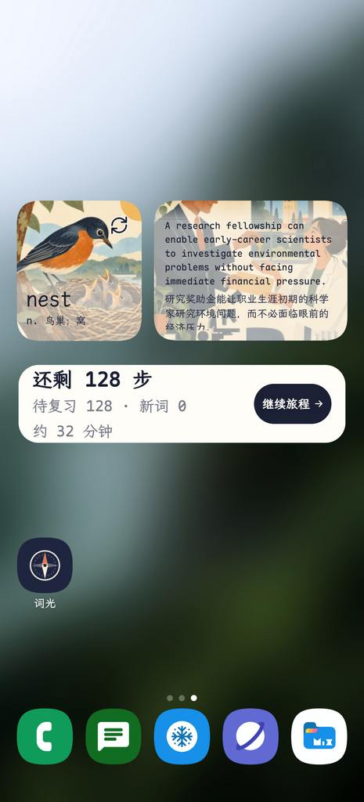
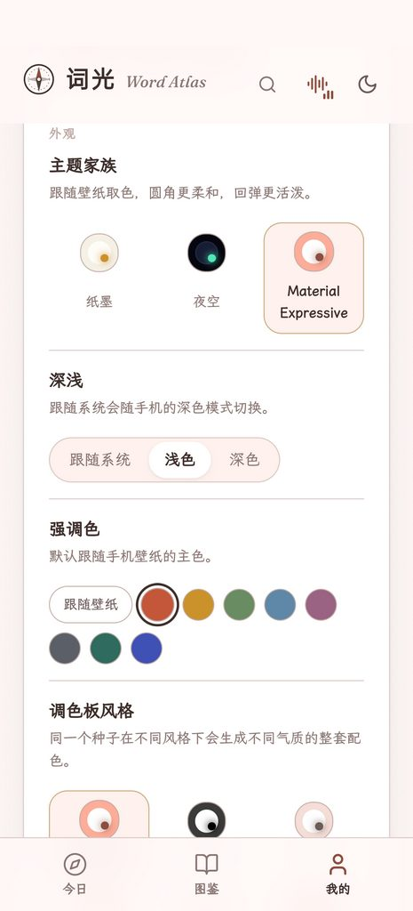

<div align="center">

<table align="center">
  <tr>
    <td></td>
    <td></td>
    <td></td>
    <td></td>
    <td></td>
  </tr>
</table>

# word-atlas-android

**把词光装进手机：完全离线的安卓版。**

7,298 个雅思词条 · 原创插画 · 内置英美语音 · 真题例句 · 零权限 · 断网可用

[](LICENSE)
[](CONTENT_LICENSE.md)


[English](README.en.md)

</div>

---

## 与上游 word-atlas 的区别

内容相同，运行方式不同。上游管怎么把词背下来，这个仓库管怎么让它在没有网络、没有服务器、没有系统语音包的手机上跑起来。

### 一张表看清

| | **word-atlas**（上游原版） | **word-atlas-android**（本仓库） |
| :--- | :--- | :--- |
| 交付形态 | 网页应用 + 开放词库 | 安卓 APK（内含同一份前端） |
| 运行环境 | 浏览器访问网站或 `npm run dev` | 安卓 WebView，`file:///android_asset/www/index.html` |
| 网络 | 需要：媒体按需加载，可缓存供离线使用 | **完全不需要**：清单里没有任何权限，不含 `INTERNET` |
| 本地服务 | Vite dev server / 静态托管 | 不启动服务、不监听端口 |
| 数据加载 | `fetch()` 拉分词片 | 构建期内联为 `atlas-embed/data.js`，资源随包 |
| 语音兜底 | 浏览器 `speechSynthesis` / 系统 TTS | APK 内置 Kokoro-82M（sherpa-onnx），不需要系统 TTS |
| 保存与分享 | 浏览器下载链接 | 存到「下载 / Word Atlas」，随后拉起系统分享面板 |
| 外部查词 | 无（只能在自己的搜索框里查） | 注册 `PROCESS_TEXT`（长按选词 → 翻译）与 `ACTION_SEND`（分享文本），把别的 app 里的词直接送进图鉴搜索，并记入「最近查过」 |
| 界面主题 | 浅色 / 深色 / 跟随系统 | 三套家族：纸墨、夜空（极光 / 星光）、**Material Expressive 2025**（跟随壁纸取色、8 色精选板、9 种调色板风格，并带自己的圆角阶梯与弹簧缓动），外加三种英文字体、一种内置中文字体（霞鹜文楷），以及界面缩放与字体大小各五档 |
| 词卡 | 单个音标行 | 支持同形异音，英音与美音并列；音标下面多一条**词源图景**，底部多一栏**同根词**；点词头看音节；例句、译文、搭配、词族、同根词、近义与释义里的词都能点开小窗 |
| 真题 | 无 | 「雅思语境」下面多一节**真题例句**，1,211 条剑桥雅思 4 原文与译文，含出处 |
| 话题星座 | 无（只有词汇星图） | 图鉴里多一块**话题星座**面板，十九个话题各一个星座 |
| 环境声 | 无 | **30 条**循环录音，配平响度，读词时自动压低 |
| 体积 | 仓库约 1 GB 资源 | 分享版 **1.40 GB** / 私用版 **1.34 GB** |
| 更新方式 | `git pull` / 网站自动更新 | 重新构建并安装（换签名需先卸载，别忘了提前导出备份） |
| 构建工具 | Node + Vite | 再加 JDK 17 以上和 Android SDK，**不需要 Gradle** |

### 三条硬保证

| 保证 | 怎么做到的 |
| :--- | :--- |
| **不能联网** | `AndroidManifest.xml` 里没有任何 `<uses-permission>`。缺少 `INTERNET`，系统内核拒绝为该 UID 创建 socket，代码层绕不过去。另设 `usesCleartextTraffic="false"` 与只信任系统证书的 Network Security Config。 |
| **没有服务器** | 页面从 APK 内的 `assets/www` 直接以 `file://` 打开，图片和录音相对引用。整个应用不监听任何端口，不做请求拦截代理。 |
| **没有运行时下载** | 词库索引、73 个词条分片、真题例句与音节标注索引、17 段界面音效在构建时内联；三十条环境声各打成一条按需注入的脚本（`file://` 下 `fetch()` 不可用），选中哪条才加载哪条；26 个查词兜底分片、7,298 幅插画、7,298 张缩略图、29,402 段录音作为文件放进 APK。运行时没有一次网络请求。 |

另外：不含账号、埋点、统计或第三方 SDK。

### 为手机补的几处

这一版在移植之外还做了这些：

- **词卡近义补上了同义词学习词典。** 从《牛津英语同义词学习词典》的 2,370 个同义词组里，按卡片义项中文释义的匹配分 ≥0.3 取同词性组：2,175 张卡新增 7,774 个词，近义总数从 20,745 到 28,518。组内词与原有近义按大小写不敏感去重，不设 6 个的硬上限；`strong` 现在有 `muscular`，`body` 有 `skeleton`、`physique`、`build`，同时不会把「味道浓烈」「光线强」那几组混进来。解析与合并脚本是 `scripts/atlas/thesaurus.py` 和 `scripts/atlas/import_thesaurus.py`。
- **近义按义项分行。** 4,531 张多义项词卡把近义按义项分行显示，但不标义项名，只把英文词分开；词卡没列的义项不再硬塞，统一放到最后一行。9,281 个词落进具体义项，10,972 个留在最后一行，另有 866 张卡全部落在最后一行。每义项最多展示 8 个，多出来的也进最后一行；`syn_sense` 与 `syn` 等长，`-1` 表示词卡没有对应义项。生成脚本是 `scripts/atlas/build_relations.py`，逐条关系留在 `scripts/atlas/relations.json`。
- **查词小窗能兜底不在词光词库里的词。** 点到的词若不在 7,298 张词卡里，小窗会从随包的 ECDICT 精简表补一条英/美音标、词性与中文释义，仍然明说「这个词不在词光词库里」，发音交给内置 Kokoro，不显示插画，也没有「查看词卡」。表里 341,575 个英文单词语，按首字母分成 26 片（约 26 MB），只在这一步按需读取，缓存最近 4 片；网页版走 `fetch`，APK 从 `assets/www` 读同一份文件。生成脚本是 `scripts/atlas/import_ecdict.py`。
- **学习界面按「一屏」重排。** 手机上原来四个选项加反馈卡放不进一屏：作答后的反馈是吸底浮层，正好盖住后两个选项，图片题还得再往下滑才看得全。现在会话页锁在 `100dvh`，提示区弹性收缩（插图、听音球、拼写配图都按 `dvh` 封顶），选项固定在底部槽位；作答后反馈卡**顶替**选项的位置，不再遮挡。桌面端仍是双列选项加并排反馈。
- **答题与词卡按拇指重排。** 四个选项从 54 px 长到 68 px，离屏幕底边从 8 px 抬到 26 px，并撤掉 1–4 序号（数字键仍能选，只是不再画在按钮上）。作答后的卡片不再只是「看一眼」：可以直接播放单词和例句，点词头进入完整词条，例句中文可以先高斯模糊、点一下才显示；例句、译文、常用搭配、词族、近义词，连释义里那半句英文，都能点开小窗查词。「我的」里还能让日常例句、雅思语境例句跟着单词一起自动朗读，一条读完接下一句，切走即停。
- **词卡下面多了真题例句。** 从第三方的《雅思真题例句词典》导入 1,211 条剑桥雅思 4 的原文与译文，2,216 个词条用得上：在「雅思语境」下面多一节「真题例句」，标着出处（`C04T2L3` 就是剑 4、Test 2、听力 Part 3），带中文翻译，一个词有多条时点「换一句」往后翻。这些句子没有录音，朗读交给 APK 自带的 Kokoro。导入脚本是 `scripts/atlas/import_ielts.py`，只收句子中真的出现了该词的那几条。词典本身也会把 `visitor` 链到只讲 "a variety of shopping" 的句子上，那种显示出来只会让人困惑。
- **词头点一下看音节。** 点词卡上那个大单词，字母之间会浮出「·」，`ex·hib·ition`，再点一下复原。分隔点直接取自《牛津高阶》词条自带的 `syllable` 属性（`scripts/atlas/import_syllables.py` 从 OALDPEX 里抽出来，4,672 个词条有），所以和纸质词典的断法一致。试过用同一批标注训切分模型去补词典缺的部分，双音节词也只有 82% 能对上，所以没标的就是没标：`study`、`hotel` 这类词点下去没有变化。
- **词卡多了词源图景。** 音标下面、释义上面多一条「词源图景」，一句话把词根的字面义讲清楚：`concur` 是 `com-`（共同）加 `currere`（跑），字面意思「一起跑向同一个终点」；`library` 的 `libr-` 原本是「树皮」，那是书的前身。6,754 个词条有这一节（92.6%），缺的是专名、英式拼写与不规则复数（`Thursday`、`colour`、`children`）。同一份词源词典还补上了**同根词**一栏和近义辨析里的词：`rebellion` 下面的 `belligerent`、`bellicose`、`antebellum` 都源自拉丁语 `bellum`（战争），点开就能查。解析脚本是 `scripts/etymology/import_etymology.py`。词源词典是 `Encrypted="2"` 的 MDict，键表加密、记录块是普通 zlib，所以脚本只读记录块，不碰键表。
- **图鉴里多了话题星座。** 十九个雅思话题各有一个星座，画在本话题自己的星上：先在本话题的星云里用带种子的 Poisson 采样挑出一撮相邻的词，再用一棵**互不相交**的生成树连起来，所以图形不会打结；55% 的概率再加一条长弦，但要求两端度数小于 3、长度不超过中位边的 1.5 倍、树上至少隔三跳，这样永远不会连出三角形。某个话题里学过的词到八成，星座就在星图上亮起来，卡片与星空两处统一为「未点亮全虚线、点亮后金色实线加辉光」两种状态，进度交给下面的进度条。点卡片，星图会飞到它跟前。

  图形保持二维，靠的是每个话题在盘面里另有一团二维「星云」（沿切向的长轴 + 径向的短轴，cos² 衰减，0.15 之外归零），只有云心附近那段臂上的词会被推开。曾经试过直接放宽螺旋臂的角向散布，结果整片星空的彩色分区被搅成一团灰紫，星云是唯一不牺牲话题配色的做法。连线只落在本话题的词上。

- **环境声来自真实录音。** 30 条循环：雨、海、林、火、咖啡馆、虫鸣、蛙声、风雪、篝火、列车、琴键、竹笛、古琴、竖琴……来自另一个开源学习站 [gjenglish.com](https://gjenglish.com) 的[仓库](https://github.com/wenchester8-droid/english-starry-sky)，按固定 commit 取原文件（大部分是 Pixabay 录音，按 Pixabay Content License 使用；三条由上游自己合成）。每条都按上游的 dB 表配平过响度，换曲不用重调音量；读单词时自动压低到三成，切到后台会淡出、回来再淡入，选过的那条下次打开还在。`scripts/fetch_ambience.py` 负责取回并记录每条的字节数与 SHA-256，`--check` 可逐条复核。

- **键盘不再挡内容。** 打字页用一个透明 `<input>` 接管输入，它在挂载时就已聚焦，之后再 `focus()` 是空操作，WebView 因此不再唤起输入法，真机上点屏幕没反应。现在先 `blur()` 再 `focus()`，并经原生桥接显式 `showKeyboard()`；`viewport` 补了 `interactive-widget=resizes-content`，键盘弹起时按缩小后的视口重排，拼写与打字的输入区始终在键盘上方。
- **内置离线语音。** 第二条例句（雅思语境）原先只有 1,011 个词有录音，其余 6,287 个词走系统 TTS，在没装英文语音包的机器上就是"点了没声音"，后来改由 APK 自带的 Kokoro-82M 合成。1.0.8 把缺的 6,287 条从上游公开站点按词条镜像补齐（句子与本地逐字一致，格式同为 44.1 kHz 单声道 64 kbps），现在两句例句都是真人录音，只剩真题例句仍交给 Kokoro 合成，24 kHz，点击前预渲染，按下即出声。
- **分享卡片能用。** `file://` 下每个文档是独立不透明源，`drawImage` 会污染 canvas，`toBlob()` 直接返回 `null`。改成把插图读成 `data:` URL 再绘制；保存后由原生层用 `ACTION_SEND` 拉起系统分享面板（WebView 不支持 `navigator.share({files})`）。
- **系统返回键有层级。** 先关查词小窗，再关词卡，再回上一页，最后才退出应用。
- **主题跟着手机走。** WebView 的 `prefers-color-scheme` 回答的是"应用自己的主题"，所以「跟随系统」在浅色手机上曾经永远深色；现在由原生层读 `Configuration.uiMode` 主动同步给页面。Material Expressive 家族更进一步：原生层把壁纸采样色经桥接交给页面，整套配色（22 个 CSS 变量）在运行时从头算出来，读不到时退回品牌陶土色；圆角与弹簧缓动是独立于配色的静态令牌。设计说明见 [`docs/theme.md`](docs/theme.md)。
- **中文可以换成霞鹜文楷。** 1.1.0 起「我的 → 中文字体」多一档 **霞鹜文楷**（LXGW WenKai Screen，GB 简体子集，97 个 `unicode-range` 分片共约 4.3 MB，随包内置、离线可用）。它只插在拉丁字体之后、系统中文之前，所以英文单词与数字的字形不变，中文（UI 标签、例句中文、释义、大标题）才换成文楷；默认仍是系统字体。这一档和主题一样属于**设备口味**，`导出备份` 会把它剥掉，换机后回到系统字体。

- **界面缩放和字体大小各五档。** 1.1.0 起「我的 → 外观」多了两行：**界面缩放**（90% / 95% / 100% / 105% / 110%）整页等比，卡片间距、按钮高度和底部导航一起变；**字体大小**（小 / 标准 / 大 / 特大 / 超大）只放大正文、释义和例句，标题与按钮不动。两者可以叠加，也都不随备份迁移。

- **三种例句各调各的朗读速度。** 1.1.1 起「我的 → 声音」里两个自动朗读开关并排在一起，下面三行是 **日常例句速度**、**雅思语境例句速度**、**真题例句速度**：各自 0.1×–3.0×、步进 0.1、默认 1.0×，滑块两头的 −/+ 正好走一档，右侧实时回读倍数。只改例句的快慢，单词发音不动；自动朗读、词卡与答案卡上的例句喇叭、听写的「再听一遍」都按各自那一档走。三项和主题、中文字体一样属于**设备口味**，`导出备份` 会把它们剥掉，换机后回到默认的 1.0×。
- **顶栏就是搜索框，往下拉也能搜。** 1.1.1 起手机上不再显示「词光 Word Atlas」那行字，指南针标留在原位当回首页的入口，省下的宽度全部给搜索框：点一下就是完整的查词面板。三个根页面（今日、图鉴、我的）滚到顶再继续往下拉，顶栏下面会滑出一枚「下拉搜索 / 松开搜索」的提示，松手即开，不必再滚回顶部去找放大镜。提示只在真正到顶时出现，横滑话题芯片、拖星图、词卡打开时都不会误触。
- **词卡下滑就能关。** 卡片拉到顶以后继续往下拉，面板跟着手指走、背后的遮罩同步变淡，超过 96 px 松手即关闭，拉不够则弹回；这也是右上角那个圆形 X 被去掉的原因——它原来正压在插画上。关卡的途径仍然有四个：下拉、点遮罩、系统返回键、桌面 Esc。
- **从今日进图鉴，直接落在列表里。** 「学习路线」的 A1…C2 和「按雅思话题查词」的瓷砖都改成交付 `view=list`，跳过去就是词头列表，不再是图片墙；难度行与话题行都会把对应的 chip 滑到视野中央（已经在视野里就不动，`prefers-reduced-motion` 时直接跳过去）。这个视图只对这一次跳转生效，不会改掉你在图鉴里手动选的网格/列表偏好。
- **打字练习认两种拼写，跳过不再算满分。** 图鉴里 `litre` 与 `liter` 各是一条词卡，打字台过去逐字符比对，另一种拼法会被判错、卡住不放行。现在内置 61 组英美拼写对照，单词与整句都按「任一拼法都对」判定（标点仍要一致），`practice / practise`、`licence / license` 这类在英式英语里意思分家的七组故意不合并；判对时还会标出两种写法。另外，跳过或看答案的题现在计入分母并注明确有几道跳过，不会再出现「十题全跳过 → 准确率 100%」。
- **「导入备份 / 清空记录」能点了。** 壳层漏配 `WebChromeClient` 时，`confirm()` 静默返回 `false`、文件选择器根本不弹。补上 `onJsConfirm` / `onShowFileChooser` 后恢复。
- **进度能搬到网页版，也能搬回来。** 上游网站的导入比本机严得多：它会把整份文件重新过一遍自己的校验器，`progress.drills` 缺失、或它认识的 22 个设置项里少一个（`examDate`、`illus`、`recall`……），就整份拒收，本机原来的导出因此总是得到「备份内容不完整或格式有误」。「我的 → 数据」里因此多了两个按钮：**导出网页版兼容备份**补上 `drills: {}` 与它要的全部设置项（本机独有的 30 条环境声只送它认得的 8 条，其余按 `stars`；`days` 里 `c > r` 会夹到 `r`），**从网页版备份导入**把 `drills`、`books`、考试计划这些本机没有的字段丢掉，保留卡片、每日统计和它能表达的设置。规则抄在 `src/store/web-backup.ts`，八条测试逐项复刻上游的校验；实机导出的 895 词备份在 [0xlei.tech/words](https://0xlei.tech/words/) 上直接提示「已恢复 895 个词的学习记录」。
- **查过的词能找回来了。** 上游网页版的搜索面板有「最近查过」，安卓版之前只有一个静态提示行。现在对齐上游并放大：搜索面板空查询时先列**最近查过的 6 条**，标题右侧是「清空」和「查看全部 N 条 →」；一条都没有时改推 6 个按本地日期轮换的「试试这些词」。点搜索结果、推荐词、历史词，或在图鉴里输过关键词后点开某个词，都会记一次；练习页的「最近学过」是 FSRS 学习进度，与它互不相干。独立的 `#/history` 页列出全部记录（最多 **20** 条），按最近优先、只编序号**不记时间戳**，从「我的 → 查词历史」进入，空状态可以直接唤起搜索面板。数据放在独立的 `word-atlas:recent-search` 键里，是一条纯 `string[]`（`[id, ...旧.filter(x => x !== id)].slice(0, 20)`），**不进 `Progress`、不进任何备份、不随「清空记录」一起删除**；坏 JSON、写入失败、换词库后的陈旧 ID 都只是静默降级。面板还补回了上游的移动端点按：右上「取消」、键盘 `enterKeyHint="search"`，并注册成 overlay，让系统返回键先关面板而不是直接退页。实现与十条单测见 `src/lib/recent.ts`、`src/lib/recent.test.ts`。
- **别的 app 里也能查词了。** 1.0.10 起词光注册了 `ACTION_PROCESS_TEXT` 与 `ACTION_SEND`（`text/plain`）两个意图过滤器，因此长按任意应用里的一个词即可在「翻译」选择器里选中词光，或在分享面板里把一段文本分享给词光。原生层从 `EXTRA_PROCESS_TEXT` / `EXTRA_TEXT` 取出文本，构造 `#/atlas?q=<词>&waSource=external` 加载页面；图鉴页看到 `waSource=external` 就把匹配到的词写进「最近查过」，与在应用内搜索完全同一条路径。两个过滤器都不新增任何权限，仍然零权限、完全离线。实现见 `android/app/src/main/AndroidManifest.xml` 的 `MainActivity` 意图过滤器、`MainActivity.java` 的 `launchUrl`，以及 `src/pages/Atlas.tsx` 的外部来源处理。
- **整套界面音效换成星空音色，点按判定改到抬手时。** 1.0.11 之前只有翻卡、判题、打开词条这几个动作有音效，`tap.mp3` 备了料却一直没接线。接上之后逐段量过全部 47 个音频，问题出在上游 `scripts/atlas/build_sfx.py` 的 UI 母带链里有一句 `afade=t=out:st=0:d=0.001`，从 **0 秒**开始 1 ms 淡到 0，把 9 个 cue 全截成「开头约 10 ms 一点波形 + 后面整段数字静音」（源文件峰值 −21 ~ −32 dBFS），再乘偏低增益和默认环境声，手机上基本听不见；`twinkle` 波形完整但按 `I=-24 LUFS` 母带、增益 0.22 也偏轻。现在由 `scripts/atlas/gen_cosmic_sfx.py` 调 **ElevenLabs 音效生成 API** 重做 11 段（tap / key / flip / page / correct / wrong / start / complete / streak / twinkle / splash-burst）：提示词明确要求 0.8–2.5 kHz 的**有音高玻璃钟琴单音**，并禁止低频轰鸣与气声嘶声。第一版提示词太「氛围」，`start` 的能量几乎全在 500 Hz 以下（手机上几乎无声），另几段全是 4 kHz 以上的沙沙声，已全部推翻重生成；手工正弦合成的版本也因音色发闷、千篇一律而弃用。母带在 Python 里裁掉前后静音、600 Hz 高通、把最响 100 ms RMS 统一到 −20 dBFS 并保留 −3 dBFS 峰值上限，原始 take 缓存在 `.local/forge/sfx/`（不重复扣费），每段还校验 500 Hz–4 kHz 能量确实占主导。播放增益按环境声底噪（约 −31 dBFS）统一标定为 0.60（tap 0.45），11 段有效响度落在底噪之上 3.6–6.1 dB，与原本就清晰的 `fly`（6.0 dB）/ `ignite`（9.0 dB）同一档，**17 段全部可闻**；`build_sfx.py` 已跳过这 11 个名字并修掉那句 afade，免得重跑母带把静音版本写回去。上游同源问题已提交 [designfuchen/word-atlas#48](https://github.com/designfuchen/word-atlas/issues/48)。
- **滑动不再被当成点击。** 反馈原先在 `pointerdown` 就触发，手指从按钮上开始滑动/滚动也会响一声、震一下。现在改成 `pointerup` 判定真正的轻触：位移超过 10 px、长按超过 600 ms、`pointercancel`、第二根手指落下都会作废；再加 130 ms 冷却，连点和双击不会连成一串。只认**真实控件**（按钮、链接、开关、分段选择、滑块、下拉框），点空白处、拖星图、点非按钮卡片一律不反馈；键盘 Enter / 空格激活仍会补一次。每次操作**只震一下**，翻卡 / 判题由键盘触发时补一下（触摸时已震过就自动让开），页面切换、打字完成、打开词条不震。音效引擎：带软限幅的独立总线、最多八条并发、首尾 1.5 ms / 12 ms 包络、启动预解码、环境声不经过限幅器。「我的 → 界面音效」正下方新增**界面震动**开关，两者互不影响：关掉音效仍可震动，关掉震动仍有声音；打开时立刻给一段示例震动。震动由原生 `WordAtlasAndroid.vibrate()` 走 `View.performHapticFeedback`（轻点 / 点击 / 成功 / 判错各一档），由窗口管理器代发，**不需要 `VIBRATE` 权限，manifest 仍然一个 `<uses-permission>` 都没有**；网页版退回 `navigator.vibrate`。另外补齐了**拼写题（「继续旅程」里的打字）**的音效与震动：IME 输入不产生 pointer 事件，全局轻触监听根本看不到它，所以 `SpellInput` 之前既没有 `cue("key")` 也没有震动，只有练习页的打字有声音；现在两处共用 `typingFeedback()`，逐字符播放打字机音、震动按 110 ms 节流避免连打变成持续嗡嗡，`key.mp3` 也换成 ElevenLabs 生成的**单次按键**老式打字机 clack（生成多个候选用起音点分析挑出只有一下的，母带裁到 0.12 s，即使模型返回连打也只保留第一下；中频主导、无嘶声），启动时预解码保证第一个字符就出声。实现见 `src/lib/feedback.ts`、`src/lib/sound.ts`、`src/lib/native.ts`、`scripts/atlas/gen_cosmic_sfx.py` 与 `MainActivity.Bridge.vibrate`。
- **底部导航可以只留三栏。** 「我的 → 外观」新增「隐藏练习」开关：打开后底部导航只剩今日、图鉴、我的三栏，三者自动等宽占满整行，不再留出右侧空白，也不会把「我的」挤到左边；今日页没有进行中的学习时，那个「打字练习」入口也一并收起。站在练习页时打开开关会自动跳回今日，避免停在已隐藏的页面；该设置随备份与网页版互通。

完整实现、体积构成与逐条排查记录见 **[docs/android.md](docs/android.md)**。

## 与上游一致的部分

| 项目 | 数量 / 说明 |
| :--- | :--- |
| 词条 | **7,298** 条，CEFR A1–C2，19 个话题 |
| 例句 | **14,596** 条，日常与雅思语境，附中文翻译 |
| 插画 | **7,298** 幅，512 px WebP，另带缩略图 |
| 录音 | **29,402** 段：英音、美音、两句例句朗读（日常 7,298 + 雅思语境 7,298），以及 105 个同形异音词的第二读音（分享版里 76 个词的两个读音都用 Commons 真人录音；OALDPEX 真人版仅限私用构建） |
| 复习 | TS-FSRS 间隔复习，目标记忆率可调 |
| 功能 | 今日、图鉴、词卡、词汇星图（WebGL2）、四类练习、打字练习、查词历史、外部查词（PROCESS_TEXT / 分享）、查词兜底（ECDICT 音标 / 释义）、导出 / 恢复备份（含与网页版互通） |
| 数据存放 | 本地优先，无账号无服务器，记录只在这台设备上 |

内容来源同样一致：释义、例句与搭配由大语言模型按统一词典规范撰写，插画由图像模型逐词绘制，例句朗读由 ElevenLabs 合成。经过自动结构与一致性校验，但**尚未逐条人工审校**，可能有错。不是官方雅思词表，也不承诺提分。

单词录音有两种来源。**76 个同形异音词**的两个读音都用 Wikimedia Commons 上的真人录音（Wiktionary 与 Lingua Libre；CC BY-SA 3.0 / 4.0、CC0 或公有领域，逐条授权与署名见 [docs/audio-credits.md](docs/audio-credits.md)）；其余 **7,222 个词**的读音用上游原版 ElevenLabs 录音（英音 Alice / 美音 Sarah，CC BY 4.0）。其中 **29 个**同形异音词在 Commons 上找不到第二个读音，第二个读音仍是合成音，卡片上标「合成」。这批词的真人第二读音只存在于私用版。

公开发布包不包含 OALDPEX 的真人录音。`scripts/atlas/import_audio.py` 仍可用于私用构建，把 `uk/`、`us/` 换成 OALDPEX 录音（含这 105 个词的 418 条第二读音），但那批录音版权归牛津大学出版社，仅限自建自用、不得公开分发（见 [CONTENT_LICENSE.md](CONTENT_LICENSE.md)）。

## 桌面小部件

1.0.10 新增三款**零权限、完全离线**的主屏小部件，用内容而不是焦虑把人拉回来：

- **顽固词（2×2）**：从错词本与重犯词里挑出难词，每两小时自动换一个，右上角可手动刷新；背景是该词的原创插画。
- **今日一句（4×2 / 5×2）**：每日一句雅思语境例句与中文译文，背景为词条插画，按本地日期换句。
- **进度条（4×1）**：还剩多少步、待复习、新词与预计时间，与首页同源；点按钮直接进入学习页。1.1.1 起它每个整点自己往前走：网页层发布快照时一并给出未来 25 个本地整点的投影（FSRS 仍在网页侧算），原生层到点查表刷新，App 没打开也能让「还剩 N 步」跟着到期卡片减少。

学习进度由网页层通过 `publishWidgetSnapshot` 单向交给原生层，小部件只读不写：不联网、不申请任何额外权限、不含账号或统计。三种卡面均跟随系统深浅色、可缩放，插画复用包内素材。从最近任务里划掉应用后，三张卡仍能打开对应页面，顽固词也还能继续刷新；保活的是一个没有前台状态、没有通知、也不申请权限的普通服务，整点刷新也只是一个主线程定时器，没有精确闹钟、没有前台服务。设计与实现细节见 [docs/android-widgets.md](docs/android-widgets.md)。

> 小部件已在构建链路逐项验证通过（资源编译、Java 编译、dex、签名、零权限、组件注册），桌面显示与交互（拖拽缩放、深浅色切换、刷新与跳转）也已通过真机实测。

## 安装

APK 不进仓库（`.gitignore` 已排除）。两种方式：

1. 看 [Releases](https://github.com/H1DDENADM1N/word-atlas-android/releases) 有没有现成产物；
2. 按下一节自己构建。

| 产物 | 单词发音 | 用途 |
| :--- | :--- | :--- |
| `word-atlas-android-v1.1.1.apk` | ElevenLabs 原版 + 76 个词的 Commons 真人录音 | 分享 / 公开分发 |
| `word-atlas-android-v1.1.1_O.apk` | OALDPEX 真人（牛津大学出版社） | 仅自用，不得公开分发 |

```bash
adb install -r word-atlas-android-v1.1.1.apk
```

两个包同一包名，不能同时安装；切换时覆盖安装即可，学习记录保留。

要求 **Android 7.0（API 24）及以上**，arm64 设备体验最好；安装需要约 **3.5 GB** 空闲空间。

## 版本

当前 **v1.1.1**（versionCode 15）。每个版本的改动与校验值见 [Releases](https://github.com/H1DDENADM1N/word-atlas-android/releases)。

| 版本 | 一句话 |
| :--- | :--- |
| **v1.1.1** | **进度条小部件每小时整点自动更新**：Web 层发布快照时附带未来 25 个本地整点的「还剩 N 步 / 待复习 N / 新词 N / 约 N 分钟」投影（FSRS 仍在 Web 侧算，原生只查表）；`WidgetKeepAlive` 在每个整点重新拉取快照并刷新三张卡，App 没打开时卡片陆续到期，桌面数字也会自己往前走。时钟跳变、亮屏、系统 30 分钟周期更新都会重新对齐，跨进程重启能补刷。依旧零权限、零通知、零联网：普通 Service + 主线程定时器，没有精确闹钟和前台服务。**三种例句的朗读速度分开可调**：日常、雅思语境、真题各有一档 0.1×–3.0×（步进 0.1，默认 1.0×），只影响例句、不动单词，和主题一样不随备份迁移。**顶栏换成搜索框**：手机上不再显示「词光 Word Atlas」文字，搜索框占满整行；今日、图鉴、我的滚到顶再向下拉即可唤起搜索，词卡在最顶部继续下拉即可关闭（右上角圆形 X 因此去掉）。**今日的两个入口直落列表**：学习路线 A1…C2 与话题瓷砖都以 `view=list` 打开图鉴，并将难度 / 话题 chip 滑到视野中央。**打字练习接受英美两种拼写**（61 组对照，整句同样比对），跳过与看答案不再算作 100% 正确 |
| **v1.1.0** | **Material Expressive 2025 主题家族**：首屏「我的 → 主题家族」改成三级家族（纸墨 / 夜空 / Material Expressive），夜空下再选极光或星光，M3E 下再选深浅（跟随系统 / 浅色 / 深色）、强调色（默认跟随壁纸采样色，另备 8 色精选板）与 9 种调色板风格（默认色调对比）；配色由 `@material/material-color-utilities` 的 **2025 规范**在运行时算出 22 个 CSS 变量，读不到壁纸就退回品牌陶土色，跟随系统仍由原生 `uiMode` 双向推送；M3E 家族自带 11 档圆角阶梯与更活的弹簧缓动（纸墨、夜空观感不变，仅 ±1–2 px）。**中文可选霞鹜文楷**：内置屏幕阅读版 GB 子集，默认系统字体，只换中文字形，英文与数字不受影响；主题、中文字体与两个缩放档都不随备份迁移。M3E 的「已学 / 较熟悉」与「答对 / 答错」改用固定的琥珀、绿与 M3 错误红，不再和壁纸主色撞色 |
| **v1.0.12** | **词卡近义补上《牛津英语同义词学习词典》的同词性词**：按义项中文释义匹配分 ≥0.3 筛组，2,175 张卡新增 7,774 个词，近义总数 20,745 → 28,518，大小写不敏感去重、不设硬上限；**近义按义项分行**：多义项词卡的近义按义项分行，只显示英文词、不标义项名，词卡没列出的统一放到最后一行，每义项最多 8 个；**查词小窗兜底**：词光词库查不到的词也能看到英/美音标与中文释义，341,575 个英文单词语来自 ECDICT 精简表（26 个首字母分片、约 26 MB），发音仍走内置 Kokoro，保留「这个词不在词光词库里」，不显示插画与「查看词卡」；查词提示挪到发音按钮同一行的右端，`glutinous` 近义里混入的中文残留也清掉了；**界面文案对齐网页版**：从线上站点取回最新文案，在 12 个文件里改了 118 处 label／短句（如图鉴标题、星图「随机查看已学单词」提示），不新增界面元素、不改词卡内容 |
| **v1.0.11** | **整套界面音效换成 ElevenLabs 生成的星空玻璃钟琴音色**：查明上游母带链的 `afade` 把 9 个 cue 截成 10 ms 静音，重生成 11 段（提示词限定中频有音高单音，修掉 `start.mp3` 几乎无声与高频沙沙声）并按环境声底噪统一标定增益，17 段全部清晰可闻；**轻触判定移到抬手时**（10 px 位移 / 600 ms 长按 / 130 ms 冷却），滑动不再误算点击、反馈不再过密；新增**界面震动**（在「界面音效」下面），只认按钮 / 改配置 / 翻卡 / 判题；补齐拼写题逐字打字反馈、`key.mp3` 换成老式打字机 clack；新增「隐藏练习」开关，底部导航只留三栏并等宽占满整行，今日页打字练习入口同步收起，零权限 |
| **v1.0.10** | 三款桌面小部件（顽固词轮播、今日一句、进度条，零权限完全离线）；补回**查词历史**：搜索面板「最近查过」＋独立历史页，最多 20 条、无时间戳、不进备份；**外部查词**：长按别处的词可选词光作翻译器，或在分享面板把文本发给词光直接搜，结果同样进「最近查过」 |
| **v1.0.9** | 词卡多了**词源图景**与**同根词**：6,754 个词条在音标和释义之间多一句词源小结，近义也补上了辨析里的词 |
| **v1.0.8** | 雅思语境例句的录音从 1,011 条补齐到 7,298 条：两句例句都能离线听真人朗读，只剩真题例句交给内置语音 |
| **v1.0.7** | 中文搜索能查到单词的全部义项：搜「缠绕」「蜿蜒」也能找到 wind，结果里显示命中的那条释义 |
| **v1.0.6** | 105 个同形异音词补齐第二读音，其中 76 个换成真人录音（Commons，CC BY-SA）；合成音在卡片上标「合成」 |
| v1.0.5 | 一词两音按义项分开：tear 的 /teə/（撕）与 /tɪə/（眼泪）各有各的录音 |
| v1.0.4 | 答题挖空与选项对齐；单词发音分原版分享包与 OALDPEX 私用包 |
| v1.0.3 | 图鉴新增话题星座；环境声换成 30 条真实录音；词卡多了真题例句、音节与处处可点 |
| v1.0.2 | 选项按拇指重排，作答卡能听、能点、能往下读 |
| v1.0.1 | 学习页装进一屏，键盘不再挡内容 |
| v1.0.0 | 第一个完全离线版 |

覆盖安装即可升级，学习记录保留；换过签名的包需要先卸载，记录请提前在「我的」里导出备份。

## 从源码构建

需要 **Node.js 20+**、**JDK 17 以上**、Android SDK（`platforms;android-34` 或更高、`build-tools` 34 以上；脚本会取已安装的最新版本）。不需要 Gradle，也不需要 Android Studio。

```bash
git clone --depth 1 https://github.com/H1DDENADM1N/word-atlas-android.git
cd word-atlas-android
npm ci

# 一次性拉取离线语音运行时与音色（约 540 MB，校验 SHA-256，不进仓库）
python3 scripts/android/fetch_tts.py

# 公开版音源：public/atlas/audio/{uk,us}（上游原版 CC BY 4.0；76 个同形异音词的 152 个文件来自 Commons，
# 按各自 CC BY-SA / CC0 / 公有领域授权，见 docs/audio-credits.md）
# 首次从上游 main 恢复（约 126 MB，不进 Git）：
git fetch --depth 1 origin main
git archive --format=tar origin/main public/atlas/audio/uk public/atlas/audio/us | tar -xf -
# 第二读音：public/atlas/audio/{uk2,us2}（105 个词，随仓库提供）
# 雅思语境例句：public/atlas/audio/ex2（7,298 条）。万一缺失，可从上游公开站点补齐：
# python3 scripts/atlas/fill_ielts_audio.py
# 私用版音源：private/audio/oaldpex/{uk,us}（OALDPEX，已在 .gitignore 中排除）
# 私用版导入（只在有 OALDPEX 数据包时运行；不得公开分发）：
# python3 scripts/atlas/import_audio.py --out private/audio/oaldpex

export ANDROID_HOME=$HOME/.android-sdk
export JAVA_HOME=/path/to/jdk-17

# 默认同时出两个包；也可以只出其中一个
python3 scripts/android/build_apk.py
python3 scripts/android/build_apk.py --flavors share
python3 scripts/android/build_apk.py --flavors private

# → word-atlas-android-v1.1.1.apk      （分享版，原版发音）
# → word-atlas-android-v1.1.1_O.apk    （私用版，OALDPEX 真人发音）
adb install -r word-atlas-android-v1.1.1.apk
```

两个包共用同一份 Web bundle、内联数据、`base.apk` 与 `classes.dex`，只在打包阶段换单词音源；`--skip-web` 可以复用上一次的 `dist-android`。

脚本依次执行：`vite build --config vite.config.android.ts`（相对路径 + 传统 IIFE 脚本）→ 生成内联数据 → `aapt2 compile/link` → `javac` → `d8` → 打包 assets 与 `lib/<abi>/*.so` → `zipalign` → `apksigner`（每个音源各签一次）。

只想跑网页版（和上游完全一样）：

```bash
npm run dev          # http://localhost:5188
npm test             # 单元测试
npm run check:quiz   # 全词库答题审计：挖空与四个选项
npm run build        # 构建到 dist/
```

## 体积

| 内容 | 大小 |
| :--- | ---: |
| 插画 `atlas/img`（512 px WebP） | 203 MB |
| 缩略图 `atlas/thumb` | 88 MB |
| 录音（英音 79 / 美音 82 / 例句 633） | 796 MB |
| 词库 `atlas/entries` + `index.json` | 约 10 MB |
| 查词兜底 `atlas/fallback`（26 片） | 26 MB |
| 真题例句 `atlas/ielts.json` + 音节标注 `atlas/syllables.json` | 0.6 MB |
| 界面音效（17 段） | 0.3 MB |
| 环境声（30 条循环） | 56 MB |
| 离线语音：ONNX Runtime + JNI（arm64 / x86_64） | 55 MB |
| 离线语音：Kokoro-82M 音色 + espeak 音素表 | 353 MB |
| 前端 bundle、字体、图标（含霞鹜文楷 97 个 woff2 分片，4.3 MB） | ~5.3 MB |
| **APK** | **分享版 1.40 GB / 私用版 1.34 GB** |

> 上表是分享版的构成。私用版把单词音源换成 OALDPEX（英音 49 / 美音 48），整包小 63 MB 左右。

想瘦身：只保留 `thumb/`（省 203 MB）、把录音转低码率、只打一个 ABI，或换回 Piper 音色（`fetch_tts.py --voice piper`，省约 290 MB，音质明显下降）。

## 已知限制

- **冷启动略慢**：首次要从 APK 里读取内联数据并解析。
- **体积就是代价**：分享版 1.40 GB、私用版 1.34 GB，是"全部资源装进 APK"的直接结果。
- **内置语音的延迟**：模型加载约 0.9 s；一句 7.8 s 的雅思长句合成约 3.6 s。按钮一出现就预渲染，所以正常点按是零等待，页面刚打开立刻点仍要等。
- **录音优先**：29,402 段录音优先，TTS 只补没有录音的真题例句。
- **真题例句只覆盖 30%**：来源词典只收了剑桥雅思 4 的四套题，2,216 / 7,298 个词条有例句；A1 日常词本来就不出现在学术文章里。
- **音节标注只覆盖 64%**：4,672 个词条有标注，词典没标的（`study`、`hotel`、`river`、`city`）点词头不会有变化。切错了比不切更糟，所以不补写。
- **词源图景只覆盖 93%**：6,754 / 7,298 个词条有，缺的是专名、英式拼写与不规则复数（`Thursday`、`colour`、`children`），词源词典里本来就是另一条词。同一份词典的「同根词」是按词根列的，个别条目会给出同时代同族的远亲（`dais` 下列了 `desk`），不全是严格同源，当线索看，别当词源学结论。
- **释义里的中文不可点**：切词与查词索引都只认英文，中文释义是纯文本。
- **签名**：`android/keystore/` 里是自签名开发密钥（口令 `wordatlas`）。要长期升级发布，请换自己的密钥并妥善保管；换密钥会导致已装版本无法覆盖升级。
- 内容与上游同步，上游的错这里也有。

## 开放数据

词库可以直接拿去用（Anki 牌组、小程序、评测集都行，署名即可）：

| 资源 | 入口 |
| :--- | :--- |
| 词条 JSON | [data/word-atlas.json](data/word-atlas.json) |
| 词条 CSV | [data/word-atlas.csv](data/word-atlas.csv) |
| 字段说明 | [docs/dataset.md](docs/dataset.md) |
| 插画 | [public/atlas/img/](public/atlas/img/) |
| 录音 | [public/atlas/audio/](public/atlas/audio/) |

```python
import json
from pathlib import Path

words = json.loads(Path("data/word-atlas.json").read_text(encoding="utf-8"))
b2_environment = [w for w in words if w["cefr"] == "B2" and w["topic"] == "environment"]
```

## 反馈与贡献

- **安卓壳、构建、APK 问题** → 提到[本仓库](https://github.com/H1DDENADM1N/word-atlas-android/issues)。
- **词条内容纠错** → 也可以提单，能一并回馈上游最好。
- 报告问题时请带上**词条 ID、复现步骤和预期结果**；内容纠错请附词典依据。
- 代码规范、数据同步与提交前检查见 [CONTRIBUTING.md](CONTRIBUTING.md)，安全问题的反馈方式见 [SECURITY.md](SECURITY.md)。

## 授权与致谢

| 范围 | 许可 |
| :--- | :--- |
| 应用代码 | [MIT](LICENSE) |
| 词库文本、插画与例句录音 | [CC BY 4.0](CONTENT_LICENSE.md)，署名 Word Atlas contributors（词光） |
| 单词发音：7,222 个词的读音 | 上游原版 ElevenLabs（Alice / Sarah），随上游以 CC BY 4.0 提供 |
| 单词发音：29 个同形异音词的合成第二读音 | 本仓库用 ElevenLabs 合成，随本项目以 CC BY 4.0 提供 |
| 单词发音：76 个同形异音词的两个读音（152 个文件） | Wikimedia Commons：CC BY-SA 3.0（70）、CC BY-SA 4.0（59）、公有领域（16）、CC0（6）、CC BY 4.0（1）；逐条署名见 [docs/audio-credits.md](docs/audio-credits.md)，CC BY-SA 部分再分发时须保留同样的授权 |
| 单词发音（OALDPEX 私用导入） | 牛津大学出版社，仅限本地构建，不得再分发 |
| Kokoro-82M、sherpa-onnx | Apache-2.0 |
| 查词兜底数据（`public/atlas/fallback/`） | ECDICT，MIT License，Copyright (c) 2025 Linwei；不属于 CC BY 4.0 |
| 第三方依赖与字体 | 遵循各自许可 |
| 霞鹜文楷屏幕阅读版（`lxgw-wenkai-screen-webfont`，随包内置） | [SIL Open Font License 1.1](https://github.com/lxgw/LxgwWenKai-Screen)，Copyright (c) LXGW / lxgw-wenkai-screen 作者 |

> 真题例句与音节标注分别导入自第三方的《雅思真题例句词典》与《牛津高阶》词典数据，**不在上表的 CC BY 4.0 范围内**；源文件不进仓库（`.gitignore` 已排除），随 APK 分发的只有导入后的索引。公开发布包的单词发音大部分是上游原版（CC BY 4.0），但 76 个同形异音词的 152 个文件来自 Wikimedia Commons，按各自的 CC BY-SA / CC0 / 公有领域授权分发，**不属于 CC BY 4.0**；如私用导入 OALDPEX，那批录音同样不在 CC BY 4.0 范围内。完整说明见 [CONTENT_LICENSE.md](CONTENT_LICENSE.md)。

原版应用与词库内容由 [@designfuchen](https://github.com/designfuchen) 制作并开源，见 [designfuchen/word-atlas](https://github.com/designfuchen/word-atlas)（76 个同形异音词的 Commons 录音除外，作者与授权见 [docs/audio-credits.md](docs/audio-credits.md)）。本仓库基于其 `main`（`99c00767`）派生，只做安卓离线封装。原版内容与设计归上游作者；这个分支自己的问题请提到本仓库。

---

如果这个离线版对你有用，请给本分支点个 Star。
